<p align="right"><a href="README.zh-CN.md">简体中文</a> · <b>English</b></p>

# AgentLoop-lite

[](https://github.com/YHGDSa/Agentloop-Lite/actions/workflows/ci.yml)
[](LICENSE)

A small, auditable agent runtime built with FastAPI, SQLite, and Streamlit. An explicit six-state machine manages tool calls, bounded retries, human approval, and the execution trace. The built-in tools are mocks.



## Run the offline demo

Use Python 3.12. The scripted demo runs without an API key.

```bash
git clone https://github.com/YHGDSa/Agentloop-Lite.git agentloop-lite
cd agentloop-lite
python -m venv .venv
source .venv/bin/activate
python -m pip install -r requirements.txt
python -m streamlit run ui/app.py
```

In Windows PowerShell, create the environment with `py -3.12 -m venv .venv`, then use `.\.venv\Scripts\python.exe` in place of `python` in the last two commands.

Open the URL printed by Streamlit, usually `http://localhost:8501`. The demo buttons are labeled in Chinese.

| Scenario | Expected trace |
|---|---|
| ① 正常排查 · Normal investigation | `get_logs` and `get_metrics` run, then the run reaches `SUCCEEDED`. |
| ② 高危重启 · High-risk restart | The mock tool pauses at `WAITING_APPROVAL`. Approve to reach `SUCCEEDED` or reject to reach `CANCELLED`. |
| ③ 超时重试 · Timeout and retry | A single step records two failed attempts followed by one success. |

See the [demo walkthrough in Chinese](docs/DEMO.md) for the full sequence.

## Runtime and API

The planner returns one structured plan at a time. The executor validates tool arguments against JSON Schema and uses the registry's risk, timeout, and idempotency settings. SQLite holds runs, steps, individual tool attempts, and approval decisions.

| Method and path | Purpose |
|---|---|
| `POST /runs` | Create and execute a run. Returns `201` and may stop at `WAITING_APPROVAL`. |
| `GET /runs/{id}` | Read the run state. |
| `GET /runs/{id}/trace` | Read steps, attempts, and approvals. |
| `POST /runs/{id}/approve` | Accept `{"decision":"approve"}` or `{"decision":"reject"}`, with an optional note. |
| `POST /runs/{id}/cancel` | Cancel an active run. |
| `GET /tools` | List the three mock tool contracts. |
| `GET /health` | Check service health. |

The Streamlit demo calls the FastAPI app in-process. To run the HTTP API separately, use `python -m uvicorn app.main:app`.

## Verify and evaluate

```bash
python -m pytest -q
python eval/run_eval.py
```

CI runs the offline tests and checks that the full runtime matches the expected state on all 30 scripted tasks. The baseline runs with retries, approvals, and loop detection disabled.

| Scripted metric | Baseline | Full runtime |
|---|---:|---:|
| Expected terminal status | 22/30 | 30/30 |
| High-risk calls intercepted | 0/8 | 8/8 |
| Loops intercepted | 0/6 | 6/6 |

The [evaluation report](eval/report.md) contains per-group results and examples. These metrics cover runtime behavior with a scripted planner and mock tools.

## Optional live planner

Copy [`.env.example`](.env.example) to `.env` and set `LLM_BASE_URL`, `LLM_API_KEY`, and `LLM_MODEL`. Then select the live model in the UI or run `python eval/run_llm_smoke.py`. The smoke script checks a normal run and an approval-gated run. Both use the built-in mock tools.

## Limits

- SQLite is configured for a single-process demo. Startup marks interrupted runs as failed for manual review.
- Approval expiry is enforced when the run is read or an approval is submitted.
- A trace returns all steps and attempts for a run. The default runtime limits each run to six steps.

The [design decisions](docs/DECISIONS.md) explain the state transitions and recovery policy. The project is [MIT licensed](LICENSE).
